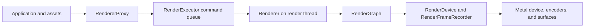
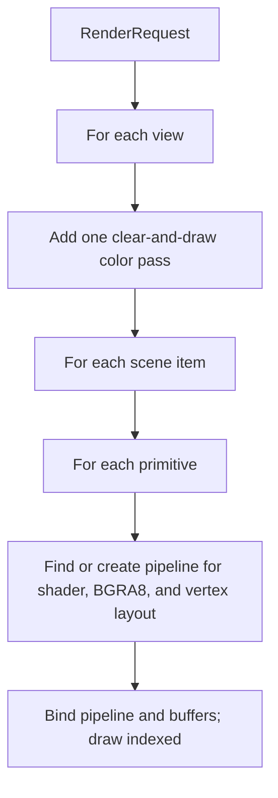

# Renderer design

This document describes the renderer as it is implemented now. The sandbox in
[`src/sandbox/main.cpp`](../src/sandbox/main.cpp) shows the complete path from a
window, shader, and primitive to a submitted frame.

Follow the [knowledge maintenance policy](README.md#maintaining-knowledge-nodes):
no ADRs; update this node from code during development, without speculative
features or interfaces.

## How a frame moves through the system

`RenderingSystem` creates the `RenderDevice`, `Renderer`, and `RenderExecutor`
on its constructing thread, then starts the executor.
The proxy puts commands on the executor's thread-safe queue. The executor
dispatches commands and calls `Renderer::tick()` on its own thread. This keeps
resource operations requested through the proxy and frame recording on the
render thread. See [Renderer messaging](renderer-messaging.md) for the exact
ownership and completion boundaries.

The application submits a `RenderRequest` containing a `RenderScene`, one or
more `RenderView`s, and a clear color. Each scene item has a shader handle, uploaded primitive handles, and named
parameter blocks, including the sandbox's model-to-world transform matrix.
The request also declares the textures and samplers that its
shaders may access, including indirect accesses. Each view names a render target
and owns its own shader parameter blocks. The sandbox puts copied view/projection
matrices there; see [Cameras](camera.md). The request is
copied into the renderer's pending queue; successful `RendererProxy::submit()`
means the renderer accepted the request, not that the GPU finished it.

The optional CPU
[`RenderRequestBuilder`](../src/engine/starlight/renderer/frontend/RenderRequestBuilder.hh)
collects draw descriptions and builds those same requests before queueing.
[`Materials`](../src/engine/starlight/renderer/shading/Material.hh) hold validated
reusable shader blocks and declared resources and expose read-only access to
that data; draws supply the remaining blocks. The builder copies draw inputs
when added and borrows materials until each build. Building validates
block names/sizes/completeness across material, draw, and view scopes for every
draw/view pair and combines dependencies into an owned request.
The sandbox uses two instances of one quad primitive with separate transforms.
Each instance selects two triangle ranges with nearest/linear checkerboard
materials. See [Shader pipeline](shader-pipeline.md)
for the material contract and its non-owning resource handles.

## Resources used by a scene

- **Shader:** `ShaderLoader` reads compiled shader bytes and adjacent JSON
  metadata with entry point names, stages, vertex inputs, and uniforms. Shader
  assets ask the proxy to create a device shader. The Metal implementation loads
  the bytes as a Metal library and looks up those entry points.
- **Primitive:** CPU `GeometryData` from the `geometry/` module contains vertex
  layout, vertex/index bytes, and counts. `GeometryDataBuilder<Vertex3>` copies
  position/normal vectors and texture coordinates with `u32` indices. Upload
  creates a buffer for each byte array and returns a primitive handle; the
  resource pool stores the layout, buffer handles, offsets, and index count. Upload validates byte sizes and triangle
  indices before allocating buffers. The sandbox retains a
  [geometry asset](geometry.md); direct proxy management also remains available.
- **Target:** The application creates a target from a surface provider, such as
  `SDLWindow`. The Metal device attaches its `CAMetalLayer` and sets its
  pixel format to `BGRA8Unorm`.
- **Pipeline:** The renderer caches a graphics pipeline by shader handle,
  color format, and primitive vertex layout. On first use, it asks the device to
  create the pipeline; later draws with the same description reuse its handle.
  The current renderer always requests `bgra8unorm`. Metal requires vertex and
  fragment shader functions and builds a vertex descriptor using the geometry's
  explicit attribute locations, byte offsets, and stride in reserved buffer
  slot 30. Frame acceptance rejects missing or mistyped shader inputs; extra
  geometry attributes are allowed. Destroying a shader removes and destroys its
  matching cached pipelines after pending frames and GPU work finish.

- **Texture and sampler:** The proxy creates immutable 2D RGBA8 textures from
  owned pixel bytes, and separate reusable nearest/linear, repeat/clamp samplers.
  The asset system retains shader/texture/sampler handles behind strong references;
  its engine-thread `update()` publishes replacements and processes cleanup.
  Handles identify stable shader table indices; generations reject stale CPU
  references after release and reuse. Each table has at most 64 entries; texture
  allocation also respects `Config::Renderer::maxTextures`.
- **Shader parameters:** Scene items carry named byte blocks. Metal binds them
  by reflected location and size. It builds a separate immutable argument-table
  snapshot for each draw item from the frame's declared resources and marks
  textures resident for vertex and fragment access. This path requires Metal 3.

`RenderTarget` can hold either a surface or texture handle, but this path still
renders to surfaces only. Sampling textures does not implement texture render
targets; the Metal recorder continues to reject those.

See [Shader pipeline](shader-pipeline.md) for the table layout, reflection
limits, and the sandbox's vertex texture coordinates.

## Recording a request

For each view, `Renderer::recordFrame()` adds one color pass named `Main Pass`.
Its attachment uses the request's clear color, `LoadOp::clear`, and
`StoreOp::store`. Every pass draws all scene items; a view does not filter the
scene. For each item, the pass combines the current view's blocks with the item's
blocks and binds the shader parameters/resource tables. For each primitive it
resolves/binds a pipeline for that primitive's layout, binds vertex/index buffers,
and calls `drawIndexed()` with the selected range's count and first index.
Selections without a range draw the whole primitive. Acceptance validates range
bounds and complete triangle alignment. Metal draws triangles with 32-bit
indices and converts first-index offsets to bytes inside the backend.

`RenderGraph` is currently a frame-local list of passes. It copies each pass's
label and color attachments, then calls `RenderFrameRecorder::renderPass()` in
insertion order. It does not inspect resource reads or writes, reorder passes,
or insert synchronization. Its role today is to group and record the passes
created for a request.

The RHI boundary uses handles and small descriptions rather than exposing
Metal objects to `Renderer`. `RenderDevice` owns resource creation, frame
submission, and GPU idle waiting. `RenderFrameRecorder` starts a render pass;
its `RenderPassEncoder` binds a pipeline and buffers and records draws. Only
graphics render passes are implemented.

## Submitting and presenting

`Renderer::submit()` queues at most `maxFramesInFlight` pending requests
(default: 3). `tick()` tries the oldest request. The Metal device has the same
number of frame slots, each guarded by a latch released when its command buffer
completes. If the next slot is busy, the device returns
`tooManyFramesInFlight`; the renderer keeps the request and retries it on a
later tick. On successful submission, it removes the request and advances its
frame number. Other recording or submission errors are logged and the request
is dropped.

For a surface pass, the Metal recorder gets a drawable from the surface layer
when it needs the attachment. It reuses that drawable if another pass in the
same frame uses the same surface. It creates a Metal render encoder, translates
the pass's load and store operations, records the callback, and ends the
encoder. After all passes are recorded, it schedules presentation of acquired
drawables and commits the command buffer. Submission returns after commit;
GPU completion happens later.

If a surface has no drawable, the recorder returns
`renderSurfaceNotDrawable`. `RenderGraph` skips that pass and continues with
other passes. Other pass errors stop frame recording. On shutdown,
`RenderingSystem` stops the executor and waits for the device's frame slots to
finish.

## Current boundaries

The implemented backend is Metal. `Platform::createRenderDevice()` selects it
for Metal builds; the Vulkan branch has no device implementation. The renderer
has no compute or copy passes, render graph dependency tracking, texture
outputs, lighting, or depth attachments. Materials are CPU parameter values,
not a surface shading model, GPU material table, or pass-specific shader system.
Sampled textures have one mip
level, initial upload only, and linear RGBA8 storage (no sRGB conversion).
The current `Vertex3` contains position/normal `float3` fields and `float2`
texture coordinates. Vertex input reflection, geometry uploads, and Metal vertex
fetching support `float32` vectors of two, three, or four elements. Attributes
use one stream with explicit stride, locations, and byte offsets; padding is
supported. Layouts permit up to 16 attributes at locations 0..15, stride up to
2048 bytes, and four-byte-aligned stride/offsets.

Shader/texture/sampler/primitive destruction drains pending frame requests and waits for
GPU idle before reclaiming resources or slots. This is deliberately blocking;
there is no deferred GPU retirement queue. Direct device-buffer destruction is
immediate. See [Renderer messaging](renderer-messaging.md).

## Source references

- [ShaderLoader](../src/engine/starlight/asset/loaders/ShaderLoader.cpp) and
  [Vertex3](../src/engine/starlight/geometry/Vertex.hh)
- [CPU geometry data](../src/engine/starlight/geometry/GeometryData.hh),
  [typed builder](../src/engine/starlight/geometry/GeometryDataBuilder.hh), and
  [RendererResourcePool](../src/engine/starlight/renderer/frontend/RendererResourcePool.cpp)
- [Renderer](../src/engine/starlight/renderer/frontend/Renderer.cpp) and
  [RenderGraph](../src/engine/starlight/renderer/frontend/RenderGraph.cpp)
- [MetalGraphicsPipeline](../src/engine/starlight/platform/metal/MetalGraphicsPipeline.cpp),
  [MetalDevice](../src/engine/starlight/platform/metal/MetalDevice.cpp), and
  [MetalRenderFrameRecorder](../src/engine/starlight/platform/metal/MetalRenderFrameRecorder.cpp)
