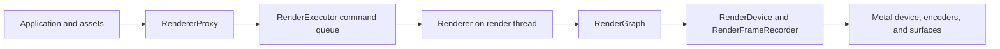
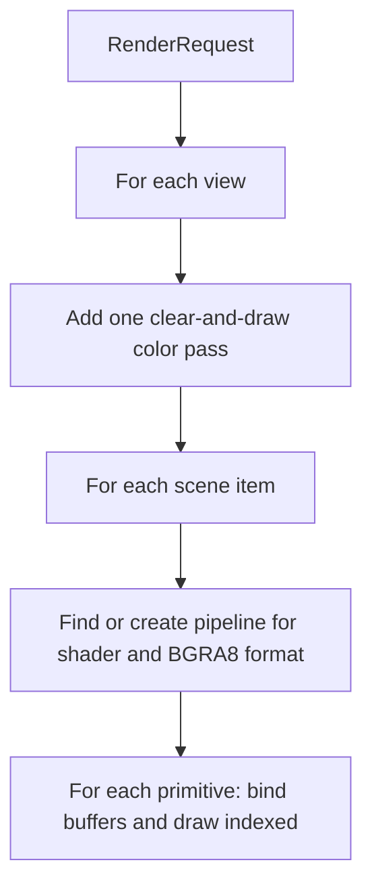

# Renderer design

This document describes the renderer as it is implemented now. The sandbox in
[`src/sandbox/main.cpp`](../src/sandbox/main.cpp) shows the complete path from a
window, shader, and primitive to a submitted frame.

Follow the [knowledge maintenance policy](README.md#maintaining-knowledge-nodes):
no ADRs; update this node from code during development, without speculative
features or interfaces.

## How a frame moves through the system

`RenderingSystem` creates the `RenderDevice`, `Renderer`, and `RenderExecutor`
on its constructing thread, then starts the executor.
The proxy puts commands on the executor's thread-safe queue. The executor
dispatches commands and calls `Renderer::tick()` on its own thread. This keeps
resource operations requested through the proxy and frame recording on the
render thread. See [Renderer messaging](renderer-messaging.md) for the exact
ownership and completion boundaries.

The application submits a `RenderRequest` containing a `RenderScene`, one or
more `RenderView`s, and a clear color. Each scene item has a shader handle, uploaded primitive handles, and named
parameter blocks, including the sandbox's model-to-clip transform matrix.
The request also declares the textures and samplers that its
shaders may access, including indirect accesses. Each view names a render target. The request is
copied into the renderer's pending queue; successful `RendererProxy::submit()`
means the renderer accepted the request, not that the GPU finished it.

## Resources used by a scene

- **Shader:** `ShaderLoader` reads compiled shader bytes and adjacent JSON
  metadata with entry point names, stages, vertex inputs, and uniforms. Shader
  assets ask the proxy to create a device shader. The Metal implementation loads
  the bytes as a Metal library and looks up those entry points.
- **Primitive:** `PrimitiveUploadData` contains vertex layout, vertex and index
  bytes, and counts. `PrimitiveUploadDataBuilder<Vertex3>` packs position and
  normal vectors with `u32` indices. Upload creates a buffer for each byte array
  and returns a primitive handle; the resource pool stores the layout, buffer
  handles, offsets, and index count. The caller can later destroy the primitive
  through the proxy.
- **Target:** The application creates a target from a surface provider, such as
  `SDLWindow`. The Metal device attaches its `CAMetalLayer` and sets its
  pixel format to `BGRA8Unorm`.
- **Pipeline:** The renderer caches a graphics pipeline by shader handle and
  color format. On the first use of a pair, it asks the device to create the
  pipeline; later draws reuse its handle. The current renderer always requests
  `bgra8unorm`. Metal requires vertex and fragment shader functions and sets a
  vertex descriptor from the shader's reflected layout, with attributes packed
  in reserved Metal vertex buffer slot 30. The renderer rejects primitives whose layout does
  not match the shader. The renderer has no pipeline eviction or shader-change
  invalidation.

- **Texture and sampler:** The proxy creates immutable 2D RGBA8 textures from
  owned pixel bytes, and separate reusable nearest/linear, repeat/clamp samplers.
  Handles identify stable shader table indices; generations reject stale CPU
  references after release and reuse. Each table has at most 64 entries; texture
  allocation also respects `Config::Renderer::maxTextures`.
- **Shader parameters:** Scene items carry named byte blocks. Metal binds them
  by reflected location and size. It builds a separate immutable argument-table
  snapshot for each draw item from the frame's declared resources and marks
  textures resident for vertex and fragment access. This path requires Metal 3.

`RenderTarget` can hold either a surface or texture handle, but this path still
renders to surfaces only. Sampling textures does not implement texture render
targets; the Metal recorder continues to reject those.

See [Shader pipeline](shader-pipeline.md) for the table layout, reflection
limits, and the sandbox's generated texture coordinates.

## Recording a request

For each view, `Renderer::recordFrame()` adds one color pass named `Main Pass`.
Its attachment uses the request's clear color, `LoadOp::clear`, and
`StoreOp::store`. Every pass draws all scene items; a view does not filter the
scene. For each item, the pass resolves its pipeline, binds it and the item's shader parameters/resource tables, then binds each
primitive's vertex and index buffers and calls `drawIndexed()` with its index
count. Metal currently draws triangles with 32-bit indices.

`RenderGraph` is currently a frame-local list of passes. It copies each pass's
label and color attachments, then calls `RenderFrameRecorder::renderPass()` in
insertion order. It does not inspect resource reads or writes, reorder passes,
or insert synchronization. Its role today is to group and record the passes
created for a request.

The RHI boundary uses handles and small descriptions rather than exposing
Metal objects to `Renderer`. `RenderDevice` owns resource creation, frame
submission, and GPU idle waiting. `RenderFrameRecorder` starts a render pass;
its `RenderPassEncoder` binds a pipeline and buffers and records draws. Only
graphics render passes are implemented.

## Submitting and presenting

`Renderer::submit()` queues at most `maxFramesInFlight` pending requests
(default: 3). `tick()` tries the oldest request. The Metal device has the same
number of frame slots, each guarded by a latch released when its command buffer
completes. If the next slot is busy, the device returns
`tooManyFramesInFlight`; the renderer keeps the request and retries it on a
later tick. On successful submission, it removes the request and advances its
frame number. Other recording or submission errors are logged and the request
is dropped.

For a surface pass, the Metal recorder gets a drawable from the surface layer
when it needs the attachment. It reuses that drawable if another pass in the
same frame uses the same surface. It creates a Metal render encoder, translates
the pass's load and store operations, records the callback, and ends the
encoder. After all passes are recorded, it schedules presentation of acquired
drawables and commits the command buffer. Submission returns after commit;
GPU completion happens later.

If a surface has no drawable, the recorder returns
`renderSurfaceNotDrawable`. `RenderGraph` skips that pass and continues with
other passes. Other pass errors stop frame recording. On shutdown,
`RenderingSystem` stops the executor and waits for the device's frame slots to
finish.

## Current boundaries

The implemented backend is Metal. `Platform::createRenderDevice()` selects it
for Metal builds; the Vulkan branch has no device implementation. The renderer
has no compute or copy passes, render graph dependency tracking, texture
outputs, a material system, or depth attachments. Sampled textures have one mip
level, initial upload only, and linear RGBA8 storage (no sRGB conversion).
The current `Vertex3` contains position and normal vectors; the demo derives UVs
from position rather than adding a vertex format. Vertex input reflection
currently accepts `float32` vectors of three or four elements.

Texture/sampler destruction drains pending frame requests and waits for GPU
idle before reclaiming resources or slots. This is deliberately blocking;
there is no deferred retirement queue. Other existing resource destroy paths
have not acquired this lifetime guarantee. See [Renderer messaging](renderer-messaging.md).

## Source references

- [ShaderLoader](../src/engine/starlight/asset/loaders/ShaderLoader.cpp) and
  [Vertex3](../src/engine/starlight/renderer/core/Vertex.hh)
- [Primitive upload data](../src/engine/starlight/renderer/core/Primitive.hh) and
  [RendererResourcePool](../src/engine/starlight/renderer/frontend/RendererResourcePool.cpp)
- [Renderer](../src/engine/starlight/renderer/frontend/Renderer.cpp) and
  [RenderGraph](../src/engine/starlight/renderer/frontend/RenderGraph.cpp)
- [MetalGraphicsPipeline](../src/engine/starlight/platform/metal/MetalGraphicsPipeline.cpp),
  [MetalDevice](../src/engine/starlight/platform/metal/MetalDevice.cpp), and
  [MetalRenderFrameRecorder](../src/engine/starlight/platform/metal/MetalRenderFrameRecorder.cpp)
